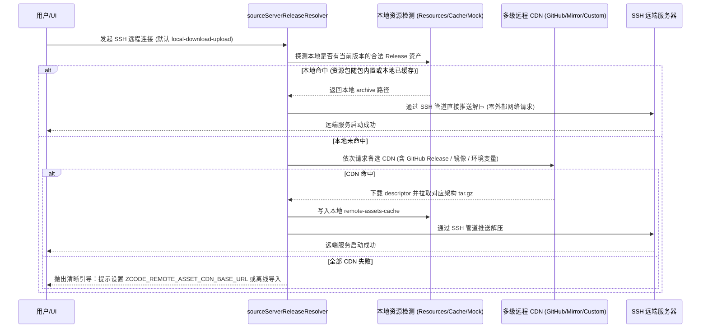

# 远程 SSH 组件分发与自洽部署规范 (Remote SSH Asset Delivery Spec)

## 一、 背景与根因剖析

### 1. 现状痛点
在桌面端尝试通过 SSH 连接远程服务器时，系统需要向远端部署配套服务组件（Node.js 运行时、`zcode-server` CLI、`node-pty` 原生预编译包、`ripgrep` 等）。但在打包运行环境下，部分安装包请求的下载清单直接指向了占位符地址：
```
http://intranet.example.invalid:12345/ssh-remote-assets/<version>/source-server-descriptor.json
```
导致清单拉取失败（`net::ERR_NAME_NOT_RESOLVED` 或连接被拒绝），阻断 SSH 部署与初始化。

### 2. 因果根因分析
1. **构建环境变量缺省**：
   桌面客户端打包时未显式设置 `ZCODE_ENV=production`。在 `packages/shared/src/env.ts` 中，`ZCODE_ENV` 默认回退为 `"test"`。
2. **测试环境硬编码占位符**：
   在 `packages/desktop/src/main/remoteCdn.ts` 中，当 `options.env === "test"` 且未配置覆盖地址时，硬编码返回了智谱内网测试桩 `TEST_REMOTE_CDN_RELEASE_ROOT = "http://intranet.example.invalid:12345/ssh-remote-assets"`。
3. **开源生态 CDN 缺失与物理隔离**：
   官方公网 CDN（`cdn.codegeex.cn` / `cdn-zcode.z.ai`）并未对开源社区版本发布对应的 `ssh-remote-assets`（返回 404）。且在大量企业内网、生产机房或离线机器上，远端主机根本无法访问公网 CDN。
4. **打包态人为割裂本地直推**：
   在 `packages/desktop/src/main/desktopRuntimeEnv.ts` 中，`isElectronAppPackaged()` 为 `true` 时，官方代码强行将 `mockCdnDir` 置为空，切断了桌面端从本地安装包或本地缓存读取组件并直接通过 SSH 推送的路径。

---

## 二、 核心原则与架构设计

### 1. 第一性原理（First Principles）
SSH 连接的本质是：**只要本地桌面与远端主机握手成功，即拥有了一条 100% 连通的双向数据传输管道**。
组件部署应优先基于客户端已有资产，通过 SSH 通道直推解包（`local-download-upload`），做到**零外部网络依赖、内网即连**。

### 2. 状态所有者与降级时序



---

## 三、 改动范围与接口契约

### 1. 构建环境与 CI 约束
- `.github/workflows/release.yml`：
  - 全局环境变量显式注入 `ZCODE_ENV: "production"`。
  - 构建产物环节加入 `prepare:remote-assets:linux`，随 Release 自动沉淀 Linux 多架构远程组件压缩包与 descriptor。

### 2. 运行时 CDN 解析能力扩充 (`packages/desktop/src/main/remoteCdn.ts`)
- 扩展生产 CDN 候选源：在官方 CDN 之外，追加开源 Release 托管地址（GitHub Releases 及国内镜像代理）作为天然兜底。
- 环境变量覆盖：优先消费 `ZCODE_REMOTE_ASSET_CDN_BASE_URL`，支持企业私有化部署镜像。

### 3. 桌面打包态本地资源识别 (`packages/desktop/src/main/desktopRuntimeEnv.ts`)
- 打破打包态强制清空本地目录的限制。在 `resolveRemoteAssetDirs` 中，按优先级探测：
  1. `process.resourcesPath/remote-assets`（随包内置）
  2. `userData/remote-assets-cache`（用户历史缓存）
  3. `packages/desktop/mock-cdn`（开发态本地产物）
- 若探测到当前版本完整的 `source-server-descriptor.json`，将其暴露给 `mockCdnDir`，使 `sourceServerReleaseResolver` 在 `local-download-upload` 模式下直接命中本地资产，避免触发网络请求。

---

## 四、 验收场景 (Acceptance Scenarios)

1. **场景 A（打包环境变量验证）**：
   在未配置 `.env` 的情况下执行打包构建，`tsup` 输出日志及编译后代码必须确认 `__ZCODE_ENV__ === "production"`，不得出现 `intranet.example.invalid`。
2. **场景 B（本地离线直接部署验证）**：
   当本地存在对应版本的 `source-server-descriptor.json` 和 `zcode-server-*.tar.gz` 时，在断网环境下通过 SSH 部署，系统成功通过本地管道推送，不发起任何外网 CDN 网络请求。
3. **场景 C（CDN 候选降级验证）**：
   当本地无缓存且官方 CDN 返回 404 时，自动回退到 GitHub Releases 备份源或用户配置的自定义源，下载清单并完成部署。
