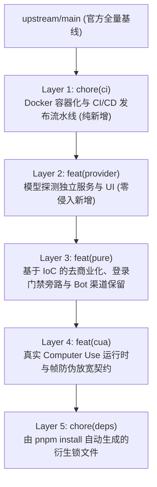

# 上游版本更新快速重放与复利治理架构规范

状态：设计与实现中（2026-10-30）  
适用范围：全工程重放工作流、`scripts/sync-upstream.mjs`、Git 分支治理、`packages/zcode-cua` 资产管理

---

## 1. 背景与第一性原理

### 1.1 现状与外部约束
- **上游更新形态**：官方仓库 `zai-org/ZCode` 采用全量源码倾倒（Wholesale Source Sync）模式，由 Sync Bot 单次提交几百至上千个文件的全量覆盖，缺乏细粒度的原子提交历史。
- **重放物理约束**：
  在 Git 3-way merge 模型中：
  $$P_{\text{conflict}} \propto \text{Upstream Volatility} \times \text{Downstream Diff Surface Area} \times \text{Coupling Depth}$$
  若下游代码改动面大、侵入深度高、或者将数十万行打包产物（Vendor Bundles）直接提交进 Git 追踪，任何上游同步都将引发严重的合并死锁。

### 1.2 复利最优原则
- **资产与负债**：
  - **正向复利资产**：基于控制反转（IoC）的守卫门禁（如 `ZCODE_PURE_EDITION`）、下沉到独立 package 的业务服务（如 `RemoteModelDiscoveryService`）、原子化正交提交历史。
  - **技术负债**：侵入上游占位包、将几十万行压缩后的构建产物纳入版本控制、手动合并锁文件 `pnpm-lock.yaml`。
- **核心目标**：
  将每次同步上游更新的边际耗时从数小时乃至数天的人肉解冲突，降低至 5~10 分钟以内的半自动/全自动流水线执行。

---

## 2. 架构设计与分层正交化

### 2.1 提交层次拓扑（4+1 规范）

下游分支相对于 `upstream/main` 的所有改动，严格划分为 4 个彼此正交的原子提交层与 1 个衍生锁文件层：



1. **Layer 1: `chore(ci)`（基础设施层）**：
   - 范围：`Dockerfile`, `docker-compose.yaml`, `.github/workflows/release.yml`, `scripts/docker-entrypoint.sh` 等。
   - 特点：100% 独立文件，与上游 0 接触，永远自动重放成功。
2. **Layer 2: `feat(provider)`（服务增强层）**：
   - 范围：`packages/services/src/model-provider/remoteModelDiscoveryService.ts`、相关测试、UI 弹窗。
   - 特点：核心逻辑位于 `packages/services` 内部独立文件，UI 挂载点仅改动两处按钮/弹窗引入。
3. **Layer 3: `feat(pure)`（纯净内核层）**：
   - 范围：`packages/shared/src/env.ts` (`ZCODE_PURE_EDITION`)、`packages/ui/src/Root.tsx`、`WorkspaceSidebarFooter.tsx` 等。
   - 特点：严格遵循控制反转，不物理删除上游任何组件或类型，仅添加 `if (ZCODE_PURE_EDITION)` 守卫。
4. **Layer 4: `feat(cua)`（CUA 运行时层）**：
   - 范围：`packages/zcode-cua/`、`apps/zcode-cli/` 的帧签名透传。
5. **Layer 5: `chore(deps)`（依赖锁文件层）**：
   - 由 `pnpm install` 自动从合并后的 `package.json` 推导生成，禁止手动合并 3-way conflict。

---

## 3. 依赖锁文件与资产治理策略

### 3.1 锁文件自动重建契约
- **事实源头**：各 package 的 `package.json` 是依赖的唯一 Source of Truth；`pnpm-lock.yaml` 仅是编译期计算结果。
- **重放规则**：
  在执行 rebase/cherry-pick 时，若 `pnpm-lock.yaml` 发生冲突：
  1. 一律接受上游版本：`git checkout --theirs pnpm-lock.yaml`；
  2. 依赖声明已随代码合并进入 `package.json`；
  3. 执行 `pnpm install --no-frozen-lockfile`，由 pnpm 算法自动增量解析下游独有依赖（如 `sharp`）；
  4. 生成唯一的 `chore(deps): 同步更新 pnpm-lock.yaml` 提交。

### 3.2 CUA 资产与占位包冲突隔离
- 在 Git 属性配置中为大文件及二进制资产设置非文本属性，或通过 `.gitattributes` 指明合并驱动行为。
- 当上游更新重置 `packages/zcode-cua` 占位包时，自动化同步工具将通过快照覆盖策略保持真实运行时，避免 Git 对 6 万行打包产物执行逐行文本三方比对。

---

## 4. 自动化重放流水线：`scripts/sync-upstream.mjs`

### 4.1 执行流程契约
```text
[1/5] 基线检查 (Working tree status, Freshness, Remotes)
[2/5] 获取上游更新 (git fetch upstream)
[3/5] 检测冲突半径与待重放原子层 (Dry-run rebase check)
[4/5] 执行重放或原子应用 (Rebase / Replay)
[5/5] 自动补全锁文件并运行质量门禁 (pnpm install -> typecheck -> test)
```

### 4.2 验收标准
1. `node scripts/sync-upstream.mjs --check`：无入侵预检上游是否有新版本待同步，输出潜在冲突文件清单。
2. 遇到 `pnpm-lock.yaml` 冲突时，脚本能够完全自动恢复并重建锁文件。
3. 同步完成后自动通过 `pnpm typecheck` 与 `pnpm architecture:check --changed`。
