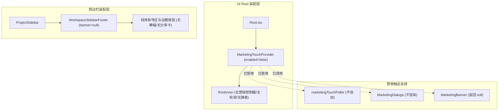

# 纯净工作区：营销触达与侧边栏推广彻底静默规范

## 1. 目标与背景

根据用户诉求与第一性原理，开发工具的本质在于高专注度的代码编写与智能体协作。桌面端及 Web 端现存的营销横幅（`MarketingBanner`）、全局营销居中弹窗（`MarketingDialogs` / `CloudContentDialog`）以及极速生成社交裂变分享卡（`HighspeedShareNoticeCard`）对开发主流程形成持续干扰，且在后台维持每 10 分钟一次的网络轮询和全局 DOM `MutationObserver` 监听，消耗计算与网络资源。

为实现长远的最优工程复利，方案拒绝通过简单的 CSS 伪隐藏（`display: none`）打补丁，而是从**状态所有者**与**装配入口**根部进行静默切断。

## 2. 状态所有者与架构切分

### 2.1 营销系统（Marketing Touch）唯一所有者：`MarketingTouchProvider`
* **规则**：`MarketingTouchProvider` 新增 `enabled?: boolean` 开关（默认为 `false`，即生产运行默认纯净静默；同时保留测试或特殊环境受控开启的能力）。
* **行为**：
  * 当 `enabled === false` 时，`createRuntime` 立即返回 `null`。
  * 不创建 `MarketingTouchController`，不创建 `marketingTouchPoller`（零网络请求、零定时器唤醒）。
  * 不注册挂载于 `document.body` 的 `MutationObserver`（零 DOM 监听消耗）。
  * 上下文提供 `null`，使得：
    * `useMarketingBannerVisible()` 恒返回 `false`；
    * `MarketingBanner` 视图返回 `null`；
    * `MarketingDialogs` 全局居中弹窗不挂载；
    * `useMarketingTaskCompletionRefresh` 上下文为 `null`，不监听任务完成事件。

### 2.2 左下角活动槽位所有者：`ProjectSidebar` 与 `SidebarBottomActivity`
* **规则**：
  * `ProjectSidebar` 是侧边栏装配的唯一所有者。在传递给 `WorkspaceSidebarFooter` 时，不再挂载可能展示推广的活动槽位（`banner` 传 `undefined` 或 `null`）。
  * `SidebarBottomActivity` 作为仲裁层组件，本身增加 `enabled?: boolean`（默认为 `false`，或在产品装配中静默），确保任何情况下左下角不产生多余的 DOM 节点与推广卡片。
  * 极速生成分享卡（`HighspeedShareNoticeCard`）不再在侧边栏左下角浮现。

## 3. 验收场景与回归验证

1. **左下角视觉与 DOM 验收**：
   * 启动桌面版或 Web 端，侧边栏底部仅保留用户身份头像、用量概览、远控入口与设置齿轮。
   * DOM 中无 `data-testid="marketing-banner"`，无 `data-global-notice-type="highspeed-share"`。
2. **全局居中弹窗验收**：
   * 即使后端接口下发 `resource_position: "popup"`，前端亦不挂载 `MarketingDialogs`，不弹出 `cloud-content-dialog`。
3. **后台网络与性能验收**：
   * Network 面板无对 `/api/v1/marketing/touch` 的周期性 GET 请求及任务完成后的刷新请求。
   * 控制台无 `[marketing-touch]` 轮询与资源加载日志。
   * 无常驻 `MutationObserver` 遍历 body。
4. **单测与类型安全**：
   * 现有 `marketingBanner.test.ts`、`sidebarBottomActivity.test.ts`、`marketingTouchProvider.test.ts` 保持测试用例受控可用性。
   * 全量 `pnpm typecheck` 和 `pnpm lint` 必须无新增 error。
