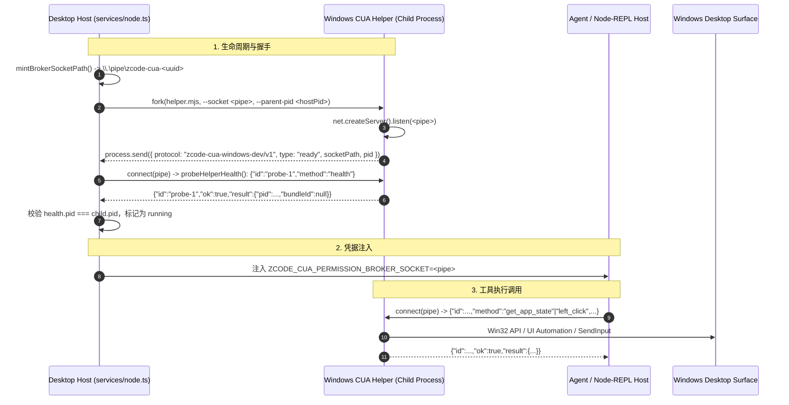

# Windows CUA 原生链路激活规范 (Windows CUA Activation Spec)

## 1. 目标与背景

当前开源 Monorepo 中 `@zcode/zcode-cua` 为占位桩（Placeholder），导致：
1. 宿主端健康探活与 Socket 铸造失败（`mintBrokerSocketPath` 返回 Unix socket 路径导致 Windows EACCES，`probeHelperHealth` 固定返回空 PID 导致强杀 Helper）；
2. Node-REPL 侧 `createComputerUseRuntime` 固定返回不可用；
3. 缺失实际可运行的轻量级 Windows CUA Helper 守护进程。

本规范定义一套完全正向、API 兼容、零反作弊风险的 CUA 链路补齐方案，使 ZCode 桌面端能原生拉起并执行 Windows 电脑操控。

## 2. 状态所有者与架构拓扑

## 3. 核心契约与接口定义

### 3.1 宿主 Broker 接口 (`packages/zcode-cua/broker.js`)
- `mintBrokerSocketPath(options)`:
  - 在 `process.platform === "win32"` 时，返回 `\\\\.\\pipe\\zcode-cua-${randomUUID()}`；
  - 在 POSIX 平台上，返回 `join(tmpdir(), zcode-cua-broker-${randomUUID()}.sock)`。
- `probeHelperHealth(socketPath, options)`:
  - 通过 `net.createConnection(socketPath)` 建立 IPC 连接；
  - 发送换行 JSON-RPC 请求：`{"id":"probe","method":"health","params":{}}\n`；
  - 超时控制（默认 5000ms），解析返回中的 `{ pid, bundleId }`；如果收到 `ok: true` 但未返回 pid，则回退发送 `ping` 并提取健康数据。
- `callBrokerMethod({ socketPath, method, timeoutMs, ...params })`:
  - 建立 Socket 连接，发送 `{ id, method, params }`；
  - 接收对应 ID 的响应行，正确抛出结构化 `BrokerError` 或返回 `result`。

### 3.2 Agent 运行时接口 (`packages/zcode-cua/index.js`)
- `createComputerUseRuntime({ brokerSocketPath })`:
  - 实现 `execute({ toolName, arguments, context, signal })`：
    - 连接 `brokerSocketPath`；
    - 发送换行协议：`{ id, method: toolName, input: arguments, context }`；
    - 适配 MCP 工具输出格式 `{ content, structuredContent, isError }`。

### 3.3 Windows Helper 实现契约 (`helper.mjs`)
- 启动参数：`--socket <pipePath>`、`--parent-pid <hostPid>`；
- IPC 握手：启动后立即 `process.send({ protocol: "zcode-cua-windows-dev/v1", type: "ready", socketPath, pid: process.pid })`；
- 必须实现的核心能力：
  1. `ping` / `health`：健康检查响应；
  2. `list_apps` / `list_windows`：枚举活动应用与窗口；
  3. `get_app_state`：提取目标窗口元素树（UIA）与屏幕截图；
  4. 交互动作：`left_click`, `left_click_drag`, `scroll`, `type`, `key`, `set_value`, `select_text`, `paste`, `perform_action`；
  5. 权限与状态：`permission_status`, `request_access`, `stop_computer_control`。

## 4. 验收测试场景

1. **管道名称跨平台格式验收**：
   - 在 win32 下输出 `\\.\pipe\zcode-cua-*`，非 win32 下输出合法 unix socket 路径。
2. **Broker RPC 与探活闭环**：
   - 建立 mock named pipe 服务，验证 `probeHelperHealth` 能正确解析并在 pid 匹配时通过。
   - 验证 `callBrokerMethod` 在发生异常、超时或正常返回时的错误码与数据一致性。
3. **Runtime 执行闭环**：
   - 验证 `createComputerUseRuntime().execute` 成功分发并返回 MCP 格式响应。
